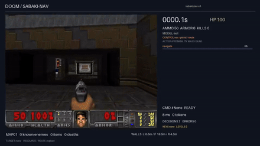

# @sabaki-js/doom

[](https://www.npmjs.com/package/%40sabaki-js%2Fdoom) [](https://github.com/sabaki-js/plugin-doom#readme) [](https://github.com/sabaki-js/plugin-doom/actions)

Doom decisions (navigation + combat arbitration).

Questions: `command`, `target`, `weapon`. Work in progress: nav MiniLM (MAP01) + vision policy (arena).

## Demo

`npm run demo` - the plugin decides on 3 canned MAP01 states (nano, no deps).

The mini model (MiniLM + exit compass) finishes MAP01 - 4/6 EXIT:



MAP01 exit on video (`assets/ep_exit_latch.mp4`, 1080p) via the Jev endpoint: `command` + `target` + `weapon` in one `/v1/systemone` call, overlayed per tick.

| run | EXIT | time |
|---|---|---|
| doomLaya scripted reference (controller) | yes | ~61 s |
| **sabaki mini + latch (`ep_exit_latch.mp4`)** | **1/1** | **36.4 s (1274 ticks)** |
| sabaki nano (TF-IDF) | 0/6 | — |

Single episode so far (variance known: mini 2–4/6) — the latch (hold `open_door` 15 ticks) fixed the door oscillation.

| mode | weights | closed loop | throughput (CPU, 1 thread) |
|---|---|---|---|
| mini (MiniLM ONNX, CPU) | `sabaki-models` | 2–4/6 | 71 req/s (i5) / 73 (Xeon) |
| nano (TF-IDF, 112 terms) | `src/weights.json` (legacy, demo only - 0/6, dropped) | 0/6 | 18 000 req/s (i5) / 12 000 (Xeon) |

`node bench_throughput.mjs [nano|mini|all] [iters]` reproduces these numbers.

## Run your own demo

The classifier runs in Node, the game in Python (VizDoom). The JS server
decides, the Python client plays - one HTTP call per game tick.

```sh
# 1. game + model stack (Python)
pip install vizdoom gymnasium pygame onnxruntime
git clone https://github.com/sabaki-js/doomLaya /tmp/doomlaya  # fork Apache-2.0 d'azalio/doomLaya, voir NOTICE

# 2. mini weights (~90 MB) + tokenizer
# from https://github.com/sabaki-js/sabaki-models/releases (doom_nav.onnx)
export ONNX=/path/to/doom_nav.onnx VOCAB=/path/to/tokenizer.json

# 3. JS decision server (needs sabaki@>=1.0.1 + onnxruntime-node)
npm i sabaki@1.0.1 onnxruntime-node
node serve_mini.mjs 8472

# 4. play one episode (second terminal)
DOOM_SERVE=http://localhost:8472 python examples/drive_serve.py 1
```

`serve_doom.mjs` serves the nano classifier instead (faster, weaker: 0/6 -
it decides well on single states but cannot navigate a full level).

## Usage

```ts
import { Sabaki } from "sabaki";
import plugin from "@sabaki-js/doom";

const sabaki = new Sabaki().register(plugin.default ?? plugin);
const r = sabaki.decide({ state: "..." });
// { domain: "doom", decision: ..., confidence: ..., plugin: "@sabaki-js/doom" }
```

Ask another question with `input.question`.

Part of [sabaki](https://github.com/sabaki-js/sabaki) - see the [GUIDE](https://github.com/sabaki-js/sabaki/blob/main/GUIDE.md).

## License

MIT
